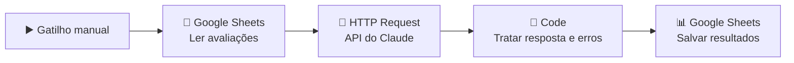

# Classificador de Avaliações de Delivery com IA

Automação no **n8n** que lê avaliações de clientes de restaurantes, usa a **API do Claude (Anthropic)** para classificar cada uma por **problema, sentimento e urgência** e salva os resultados numa planilha pronta para análise.

> Projeto construído para aprender e demonstrar, na prática, engenharia de prompts, automação com n8n, integração com APIs e análise de dados com IA.

---

## O problema

Plataformas de delivery recebem milhares de avaliações em texto livre todos os dias. Ler uma por uma é inviável, e os casos mais graves (como **riscos à saúde**) podem se perder no meio de reclamações comuns.

**Pergunta de negócio:** quais são os problemas mais frequentes de cada restaurante, e quais avaliações precisam de atenção imediata?

## A solução

Um fluxo automatizado que, para cada avaliação:

1. identifica os **problemas** dentro de categorias fixas (atraso, temperatura, item faltando etc.)
2. classifica o **sentimento** (positivo, negativo ou misto)
3. define a **urgência** com critérios de negócio: **alta** para riscos à saúde, como alergia ou comida crua
4. gera um **resumo** curto
5. salva tudo numa planilha estruturada

**Exemplo:**

| Avaliação | Problemas | Sentimento | Urgência |
|---|---|---|---|
| "Pedi sem cebola por alergia e veio com cebola. Isso é grave." | pedido_errado, seguranca_alimentar | negativo | **alta** |
| "Demorou quase 2 horas para chegar. O lanche estava bom." | atraso | misto | média |
| "Ótimo como sempre, porção generosa." | elogio | positivo | baixa |

---

## Como funciona



| Etapa | Ferramenta | O que faz |
|---|---|---|
| 1. Gatilho | n8n (Manual Trigger) | Inicia o fluxo |
| 2. Leitura | Google Sheets | Lê as avaliações da aba `avaliacoes` |
| 3. Classificação | HTTP Request → API da Anthropic (`/v1/messages`) | Envia cada avaliação ao Claude Haiku com um prompt de sistema estruturado |
| 4. Tratamento | Code (JavaScript) | Extrai o JSON da resposta, junta com os dados originais e trata falhas |
| 5. Gravação | Google Sheets | Salva os resultados na aba `resultados` |

**Tecnologias:** n8n · API da Anthropic (Claude Haiku) · JavaScript · Google Sheets

---

## Engenharia de prompt

O prompt completo está em [`prompts/prompt_sistema.md`](prompts/prompt_sistema.md). Técnicas usadas:

- **Papel definido:** o modelo atua como classificador de avaliações de delivery
- **Categorias fixas:** evita que a IA invente categorias diferentes para o mesmo problema
- **Critérios explícitos de urgência:** alta, média e baixa definidas com exemplos de negócio
- **Saída estruturada em JSON:** permite que a automação use a resposta diretamente
- **Exemplo (few-shot):** mostra ao modelo o formato exato esperado

---

## Evolução do projeto (o que deu errado e como resolvi)

### v1: primeira versão funcional
- A API retornou erro `temperature is deprecated for this model`. O parâmetro não é aceito pelo modelo atual, então **removi o parâmetro** e passei a garantir a consistência pelo prompt (categorias fixas, formato obrigatório e exemplo).

### v2: critérios de urgência
- A **validação manual** mostrou que a IA quase nunca usava urgência "média": atraso de 2 horas e pedido errado vinham como "baixa".
- **Causa:** o prompt só definia o que era urgência alta.
- **Solução:** adicionei **critérios explícitos para os três níveis**. Na execução seguinte, a distribuição ficou coerente com o gabarito.

### v3: falhas intermitentes de leitura
- Em cada execução, **uma avaliação diferente** voltava sem resposta (`erro_leitura`).
- **Investigação:** analisei a resposta bruta da API e encontrei `"stop_reason": "max_tokens"` com `"thinking_tokens": 300`. O modelo usava todo o limite de tokens **raciocinando** e não sobrava espaço para a resposta.
- **Solução:** aumentei o `max_tokens` de 300 para 1500 (é apenas um teto, então não aumenta o custo) e passei a **registrar o motivo da falha** na planilha, para facilitar o diagnóstico futuro.
- Também passei a procurar o **bloco do tipo `text`** na resposta, em vez de assumir que ele é sempre o primeiro, porque o bloco de raciocínio (`thinking`) pode vir antes.

### Qualidade de dados
- A validação também revelou uma **linha duplicada na planilha de origem**: a IA classificou corretamente, mas recebeu o texto errado. Corrigido na fonte.

---

## Validação

Comparei a classificação da IA com um **gabarito manual** das 20 avaliações:

| Critério | Resultado |
|---|---|
| Respostas no formato JSON correto (v3) | 20 de 20 |
| Categorias de problema corretas | 20 de 20 |
| Casos de risco à saúde marcados como urgência alta | 2 de 2 |

**Custo:** cerca de 400 tokens de entrada por avaliação com o Claude Haiku, o que dá **frações de centavo** para as 20 avaliações.

---

## Segurança

- A chave da API fica guardada numa **credencial do n8n** (Header Auth) e **não aparece** no arquivo do workflow exportado.
- A credencial está restrita ao domínio `api.anthropic.com`.
- Os dados usados são **fictícios**.

---

## Estrutura do repositório

```
├── README.md
├── workflow/
│   └── classificador_avaliacoes.json   # workflow exportado do n8n
├── prompts/
│   └── prompt_sistema.md               # prompt usado e decisões de design
├── codigo/
│   └── tratar_resposta.js              # código do nó Code
├── dados/
│   └── avaliacoes_restaurantes.csv     # 20 avaliações fictícias
└── imagens/                            # prints do fluxo e dos resultados
```

## Como reproduzir

1. Crie uma conta no [n8n](https://n8n.io) e importe `workflow/classificador_avaliacoes.json`
2. Importe `dados/avaliacoes_restaurantes.csv` numa planilha do Google Sheets (aba `avaliacoes`) e crie a aba `resultados` com os cabeçalhos: `id, restaurante, avaliacao, problemas, sentimento, urgencia, resumo`
3. Crie uma chave de API no [Claude Console](https://console.anthropic.com) e cadastre no n8n como credencial **Header Auth** (Name: `x-api-key`)
4. Conecte sua conta Google nos nós do Google Sheets e execute o workflow

---

## 🚀 Próximos passos

- [ ] Gatilho por **webhook**, para classificar avaliações em tempo real
- [ ] **Alerta automático** (e-mail ou Slack) para avaliações de urgência alta
- [ ] **Dashboard** com os problemas mais frequentes por restaurante
- [ ] Processamento em lote para volumes maiores

---

**Autora:** Roberta Sarah · [LinkedIn](https://linkedin.com/in/roberta-sarah)
